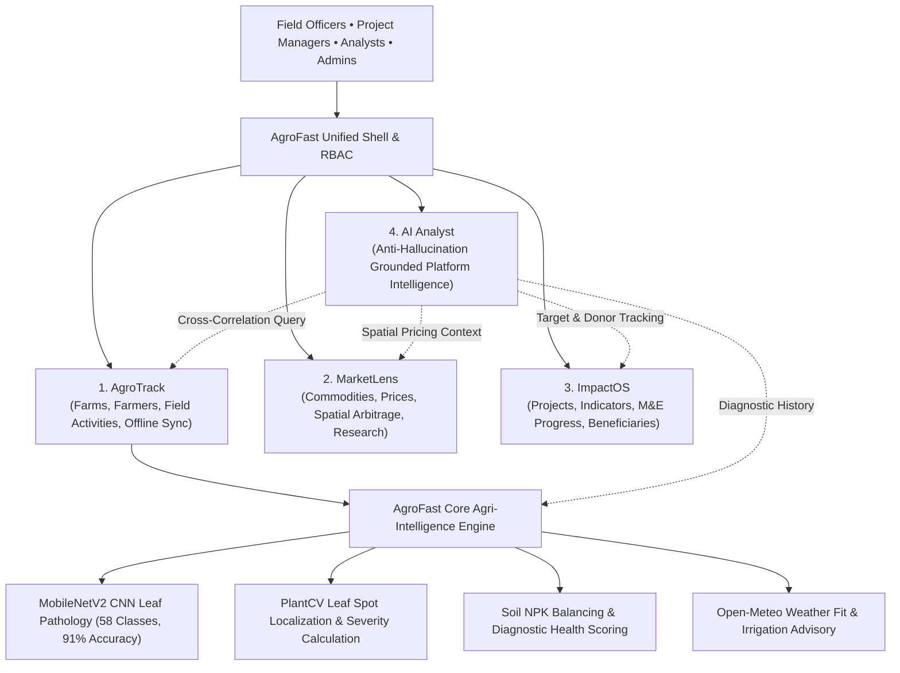

# AgroFast
### Agricultural Intelligence & Development Management Platform

[](https://www.python.org/)
[](https://fastapi.tiangolo.com/)
[]()
[]()

AgroFast is a comprehensive smart farming, agricultural intelligence, and development management agricultural intelligence and development management platform designed for agricultural cooperatives, agribusinesses, donor programs, and smallholder farmer networks.

The platform unifies on-the-ground farmer management, real-time value-chain commodity intelligence, monitoring and evaluation (M&E) project tracking, and grounded cross-module AI analytics into a single multi-tenant workspace.

---

## 1. Core Platform Capabilities

AgroFast integrates four primary modules alongside the preserved AgroFast computer vision intelligence core:



### 1. AgroFast — Farm & Field Operations
- **Farmer Management**: Comprehensive farmer registration, national ID deduplication, gender demographics, GPS validation, and soft-archive lifecycle.
- **Farm Management**: Farm plots linked to farmers, acreage tracking, soil classification, irrigation type, and soil NPK nutrient levels.
- **Field Activity Tracking**: Structured logging for farm visits, crop canopy inspections, planting, harvesting, irrigation runs, and fertilizer applications.
- **Offline Synchronization**: Field officers can log activities with zero cellular connectivity. Local queues persist in the browser and safely synchronize with idempotency checks and conflict detection when connectivity returns.
- **Unified Farm Timeline**: Chronological history tracking planting dates, field activities, CNN disease scans, and plot expenses.

### 2. MarketLens — Agricultural Market Intelligence
- **Commodity Directory**: Categorized agricultural commodities, crop varieties, and standardized units of measurement.
- **Market Price Intelligence**: Manually collected and imported wholesale/retail prices with automatic conversion to normalized per-kilogram benchmark pricing (`KES/kg`).
- **Spatial Spread & Regional Arbitrage**: Computes price variations across wholesale hubs (e.g. Wakulima vs. Nakuru vs. Eldoret) with sample size alerts and data freshness classifications.
- **Farm-to-Market Valuation**: Correlates farm plot acreage and crop yields with real-time verified market prices to determine harvest valuation.
- **Market Research Knowledgebase**: Curated field surveys, value-chain assessments, and agronomic market reports.

### 3. ImpactOS — Development Program Monitoring & Evaluation (M&E)
- **Project Portfolio Management**: Lifecycle tracking for donor-funded initiatives, budgets, start/end dates, and geographic coverage.
- **Beneficiary Tracking & PII Protection**: Enrolls smallholders, cooperatives, and agribusinesses with automatic PII sanitization (phone and national ID masking).
- **Measurable Indicators & Targets**: Track output/outcome indicators (e.g., *Hectares under Climate-Smart Agriculture*, *Farmers Trained in Soil Health*) with baseline, current progress, target calculations, and performance statuses (`on_track`, `lagging`, `critical`).
- **Program Activity Auditing**: Attendance disaggregation (gender and youth percentages) and verification evidence logging.
- **Donor & M&E Reporting**: Generates structured narrative progress reports with separate sections for verified database facts and field observations, exportable to CSV and print-ready HTML.

### 4. AI Analyst — Cross-Module Agri-Intelligence Engine
- **Cross-Module Retrieval**: Synthesizes verified data across farms, disease scans, commodity prices, and project indicators.
- **Anti-Hallucination Grounding**: Strict refusal to invent data for unmonitored commodities or unknown farms. Answers only when authorized records exist.
- **Tripartite Answer Structure**: Every response clearly separates:
  1. *Direct Database Facts* (with traceable source IDs)
  2. *Analytical Estimates & Projections*
  3. *AI Agronomic Suggestions*
- **Prompt Injection Defense**: Defense-in-depth regex interceptor preventing override attacks or credential exfiltration.

### 5. Preserved AgroFast Core Engine
- **MobileNetV2 CNN Classifier**: Pre-trained convolutional neural network supporting 58 agricultural pathology and soil classes across apple, pepper, maize, mango, potato, tomato, coffee, cassava, rice, tea, and wheat.
- **Image Quality Validation**: Computer vision pre-check verifying resolution (min 100x100px), sharpness via Laplacian variance (threshold 15.0), exposure/brightness, and binary magic bytes.
- **PlantCV Spot Detection**: Automated bounding-box spot localization and leaf severity percentage calculation.
- **Farming Advisory**: Dynamic soil NPK balancing, Open-Meteo weather fit, and irrigation recommendations.

---

## 2. Platform Architecture & Directory Structure

```
AgroTrack AI/
├── backend/
│   ├── main.py                  # FastAPI application entrypoint, middleware, static mounts
│   ├── api.py                   # Platform overview, organisation management, and memberships
│   ├── models.py                # Pydantic schemas, enums, domain entities, and RBAC models
│   ├── security.py              # JWT / Mock authentication, RBAC dependencies, token decoding
│   ├── agrotrack/               # Module 1: Farms, farmers, activities, offline sync, quality
│   │   ├── router.py            # AgroTrack API endpoints (/api/v1/agrotrack/*)
│   │   ├── service.py           # Agronomic algorithms, farm health, multi-tenant data store
│   │   └── quality.py           # Computer vision image quality and magic bytes verification
│   ├── marketlens/              # Module 2: Agricultural market intelligence
│   │   ├── router.py            # MarketLens API endpoints (/api/v1/marketlens/*)
│   │   └── service.py           # Commodity indexing, price normalization, spatial arbitrage
│   ├── impactos/                # Module 3: Development project M&E
│   │   ├── router.py            # ImpactOS API endpoints (/api/v1/impactos/*)
│   │   └── service.py           # Project tracking, indicator metrics, beneficiary registry
│   ├── analyst/                 # Module 4: Grounded AI Analyst
│   │   ├── router.py            # AI Analyst API endpoints (/api/v1/analyst/*)
│   │   └── service.py           # Anti-hallucination query dispatcher, injection defense
│   ├── ai/                      # AgroFast Core Computer Vision Models
│   │   ├── classifier.py        # MobileNetV2 inference and class mapping
│   │   ├── detector.py          # PlantCV spot localization and severity estimation
│   │   └── treatments.py        # Soil and pathology agronomic knowledgebase
│   └── tests/                   # Automated pytest suite (99 test cases)
├── frontend/
│   ├── index.html               # Public landing page and platform introduction
│   ├── overview.html            # Unified executive platform dashboard
│   ├── track.html               # AgroTrack operations workspace (GIS Leaflet maps & offline sync)
│   ├── marketlens.html          # MarketLens market intelligence workspace & price analytics
│   ├── impactos.html            # ImpactOS M&E management workspace & report generator
│   ├── analyst.html             # AI Analyst grounded natural language consultation console
│   ├── dashboard.html           # Legacy AgroFast scanner & weather dashboard
│   ├── manage.html              # Farm plot management screen
│   ├── expenses.html            # Budget tracking & expense screen
│   ├── history.html             # Leaf scan diagnostic audit log
│   ├── settings.html            # Platform profile & language configuration
│   ├── css/
│   │   └── agrotrack.css        # Professional design system & responsive styling
│   └── js/
│       ├── shell.js             # Shared navigation, role switcher, topbar & auth state
│       ├── offline-sync.js      # Resilient offline queue manager & sync modal
│       └── api-config.js        # Dynamic backend host resolution
├── database.rules.json          # Production Firebase Realtime Database Security Rules
├── firebase.json                # Firebase hosting & database deployment configuration
├── Dockerfile                   # Production container definition
├── requirements.txt             # Python dependencies
└── .env.example                 # Environment configuration template
```

---

## 3. Role-Based Access Control (RBAC) Matrix

AgroTrack AI enforces strict backend role-based access control across 14 granular permissions:

| Permission | Description | Organisation Admin | Project Manager | Field Officer | Analyst | Viewer |
| :--- | :--- | :---: | :---: | :---: | :---: | :---: |
| `org:manage` | Manage cooperative / org settings | ✅ | ❌ | ❌ | ❌ | ❌ |
| `members:manage` | Invite and assign user roles | ✅ | ❌ | ❌ | ❌ | ❌ |
| `projects:manage` | Create/edit development projects | ✅ | ✅ | ❌ | ❌ | ❌ |
| `projects:view` | View projects, targets, indicators | ✅ | ✅ | ✅ | ✅ | ✅ |
| `farmers:manage` | Register/edit/archive farmers | ✅ | ✅ | ✅ | ❌ | ❌ |
| `farms:write` | Create/update/delete farm plots | ✅ | ✅ | ✅ | ❌ | ❌ |
| `farms:read` | Read farm records & soil NPK | ✅ | ✅ | ✅ | ✅ | ✅ |
| `scans:execute` | Run CNN crop leaf diagnosis | ✅ | ✅ | ✅ | ❌ | ❌ |
| `scans:read` | View diagnostic scan history | ✅ | ✅ | ✅ | ✅ | ✅ |
| `market:write` | Record & verify commodity prices | ✅ | ✅ | ✅ | ✅ | ❌ |
| `market:read` | View commodity trends & arbitrage | ✅ | ✅ | ✅ | ✅ | ✅ |
| `impact:write` | Update indicator progress & reports | ✅ | ✅ | ❌ | ❌ | ❌ |
| `impact:read` | View M&E dashboards & targets | ✅ | ✅ | ✅ | ✅ | ✅ |
| `analyst:query` | Execute grounded AI inquiries | ✅ | ✅ | ✅ | ✅ | ❌ |

---

## 4. Field Operations & Offline Synchronization

In rural farming communities, cellular connectivity is often intermittent or unavailable. AgroTrack AI includes an offline-first architecture for Field Officers:

1. **Client-Side Queueing**: When offline, submitting an activity saves the record to browser `localStorage` with a cryptographically unique `clientMutationId` and client timestamp.
2. **Visual Status Indicator**: The top navigation bar dynamically shows:
   - 🟢 `Online`: All data synchronized.
   - 🟡 `Offline (X pending)`: Working disconnected; records queued locally.
   - 🔄 `Syncing...`: Automated upload in progress.
   - 🔴 `X Conflicts`: Inspectable conflict modal for server review.
3. **Idempotent Batch Sync**: When connectivity returns, `POST /api/v1/agrotrack/activities/sync` ingests pending activities. Duplicate `clientMutationId`s are skipped automatically without creating redundant entries.
4. **Conflict Detection**: If a target farm plot was deleted or re-assigned while the officer was in the field, the server flags the record as a conflict rather than silently discarding or overwriting data.

---

## 5. Security & Data Protection Hardening

- **File Upload Verification**: Image uploads enforce MIME checks (`image/jpeg`, `image/png`, `image/webp`), size limits (10MB), and binary **magic bytes validation** (`\xff\xd8\xff`, `\x89PNG`, `RIFF...WEBP`) to block polyglot and executable exploits.
- **HTTP Security Headers Middleware**: All responses automatically include:
  - `X-Content-Type-Options: nosniff`
  - `X-Frame-Options: SAMEORIGIN`
  - `X-XSS-Protection: 1; mode=block`
  - `Referrer-Policy: strict-origin-when-cross-origin`
- **Configurable CORS**: Origins are strictly controlled via `ALLOWED_ORIGINS` in production.
- **Tenant Data Isolation**: All data queries require authenticated organization context (`orgId`). Cross-organization queries return `HTTP 403 Forbidden`.
- **PII Minimization**: Contact phone numbers and national ID numbers are masked (`+2547 *** 44`, `******66`) across API responses and M&E reports.
- **Firebase Realtime Database Rules**: Provided in [`database.rules.json`](database.rules.json) to lock down direct client database access to authenticated owners only.

---

## 6. Installation & Quickstart

### Prerequisites
- Python 3.11 or higher
- Git

### 1. Clone & Set Up Virtual Environment

```bash
# Clone the repository
git clone https://github.com/your-org/agrotrack-ai.git
cd "AgroTrack AI"

# Create and activate virtual environment
python -m venv .venv

# Windows (PowerShell)
.\.venv\Scripts\Activate.ps1

# Linux / macOS
source .venv/bin/activate
```

### 2. Install Dependencies

```bash
pip install -r requirements.txt
```

### 3. Configure Environment Variables

Copy the example environment configuration:

```bash
cp .env.example .env
```

Edit `.env` to configure your settings:

```ini
HOST=0.0.0.0
PORT=5500
ENVIRONMENT=development
ALLOWED_ORIGINS=http://localhost:5500,http://127.0.0.1:5500
GEMINI_API_KEY=your_gemini_api_key_here
```

### 4. Run the Development Server

```bash
python backend/main.py
```

The application will be accessible at:
- **Web Platform**: [http://localhost:5500](http://localhost:5500)
- **API Swagger Documentation**: [http://localhost:5500/docs](http://localhost:5500/docs)
- **OpenAPI Redoc**: [http://localhost:5500/redoc](http://localhost:5500/redoc)

---

## 7. Testing & Verification

AgroTrack AI maintains a comprehensive automated testing suite:

### Run Automated Unit & Regression Tests (99 Tests)

```bash
pytest backend/tests -v
```

Test coverage includes:
- `test_platform_api.py`: Platform overview, roles, and module registries.
- `test_auth_rbac.py`: Token parsing, RBAC permissions, and access enforcement.
- `test_existing_ml.py`: MobileNetV2 CNN classifier, PlantCV spot detector, and NPK treatments.
- `test_agrotrack_integration.py`: Diagnostic pipelines, irrigation advisory, and farm health scoring.
- `test_agrotrack_module.py`: Farmer management, GPS coordinates, and activity tracking.
- `test_marketlens_module.py`: Commodity registry, price normalization, and spatial arbitrage.
- `test_impactos_module.py`: Development projects, indicator progress, and M&E reporting.
- `test_analyst_module.py`: Grounded AI query resolution, injection defense, and PII masking.
- `test_phase7_qa_security.py`: Offline sync batching, idempotency, magic bytes, and empty tenant resilience.

### Run End-to-End Live Smoke Tests (42 Checks)

```bash
python scratch/test_live_server.py
```

Spawns a live FastAPI instance on port 5577 and performs 42 real HTTP requests testing end-to-end integration across all modules.

---

## 8. Production Deployment

### Production ASGI Command

```bash
uvicorn backend.main:app --host 0.0.0.0 --port 8000 --workers 4 --proxy-headers
```

### Container Deployment (Docker)

```bash
# Build the production Docker image
docker build -t agrotrack-ai:latest .

# Run the container
docker run -d -p 8000:8000 --env-file .env --name agrotrack-ai agrotrack-ai:latest
```

### Firebase Database Security Deployment

To deploy the production security rules to your Firebase Realtime Database project:

```bash
firebase deploy --only database
```

---

## 9. License & Credits

Developed by the AgroTrack AI Engineering & Architecture Team.
Protected under enterprise proprietary license.
